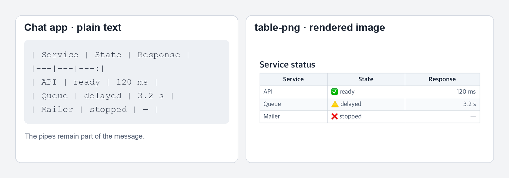

# table-png

[English](README.md)

마크다운 표를 이미지로 보여 주지 않는 메신저나 알림에서 쓸 수 있도록 PNG로 그립니다.

Python 3.9+ · Pillow

[](https://pypi.org/project/table-png/)
[](https://github.com/elfenomenokim/table-png/blob/main/LICENSE)



## 설치

```console
$ pipx install table-png
$ uv tool install table-png
```

Python 3.9 이상과 Pillow가 필요합니다. 실행 의존성은 Pillow 하나입니다.

## 빠르게 써 보기

```console
$ table-png docs/demo/status.md --out /tmp/table-status.png --title "Service status"
/private/tmp/table-status.png

$ table-png docs/demo/status.csv --out /tmp/table-status-csv.png --title "Service status"
/private/tmp/table-status-csv.png

$ table-png docs/demo/status.json --out /tmp/table-status-json.png --title "Service status" --theme dark
/private/tmp/table-status-json.png
```

`status.md`에는 마크다운 표를 넣습니다. CSV, JSON 파일도 읽으며, 표준입력은 `table-png - --out status.png`로 받습니다. 어두운 배경에 맞추려면 `--theme dark`를 쓰세요.

```markdown
| Service | State | Response |
|---|---|---:|
| API | ✅ ready | 120 ms |
| Queue | ⚠️ delayed | 3.2 s |
| Mailer | ❌ stopped | — |
```


## 필요한 이유

일부 메신저나 알림은 마크다운 표를 그대로 세로줄 문자로 보여 줍니다. `table-png`는 셀을 이미지로 그립니다. macOS, Linux, Windows에서 한글 폰트와 이모지 폰트를 찾아 쓰며, 한글 폰트가 없으면 사용할 옵션을 알려 줍니다.

<picture>
  <source media="(prefers-color-scheme: dark)" srcset="https://raw.githubusercontent.com/elfenomenokim/table-png/main/docs/diagrams/render-flow.dark.ko.svg">
  <source media="(prefers-color-scheme: light)" srcset="https://raw.githubusercontent.com/elfenomenokim/table-png/main/docs/diagrams/render-flow.light.ko.svg">
  
</picture>

셀 내용은 칸 너비에 맞춰 줄바꿈합니다. 기본값인 40행을 넘으면 PNG를 여러 장으로 나눕니다. 너비는 720–1600픽셀 범위로 맞춰집니다.

## 옵션

| 옵션 | 기본값 | 기능 |
|---|---|---|
| `INPUT` | `-` (표준입력) | 파일 경로 또는 표준입력 |
| `-o`, `--out PATH` | 필수 | 출력 이미지 경로 |
| `-f`, `--format` | `auto` | `auto`, `markdown`, `csv`, `json` |
| `--title TEXT` | 없음 | 표 위 제목 |
| `-w`, `--width PX` | `1080` | 이미지 너비, 720–1600으로 제한 |
| `--rows-per-page N` | `40` | 이미지 한 장에 넣을 행 수 |
| `--theme` | `light` | `light` 또는 `dark` |
| `--json` | 끔 | 이미지 경로와 크기를 JSON으로 출력 |

## 지원 범위

Pillow와 사용할 수 있는 폰트가 필요합니다. macOS, Ubuntu 24.04, Windows 11에서 사용했습니다. Windows에서는 국기 이모지가 국가 코드 글자로 나오고, 가족 이모지 조합은 얼굴별로 나뉘어 보입니다.

## 기여

이슈와 풀 리퀘스트를 환영합니다. 확인 방법은 [CONTRIBUTING.md](CONTRIBUTING.md)에 있습니다. 입력을 하나 렌더링하고 이미지를 직접 봅니다.

## 라이선스

MIT입니다. [LICENSE](LICENSE)를 보세요.

선택한 너비에 열이 너무 많으면 렌더링이 실패합니다. `--width`를 늘리거나 열을 줄이세요.
