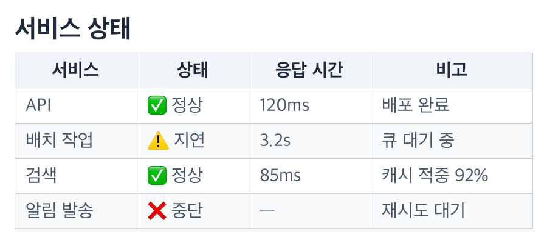
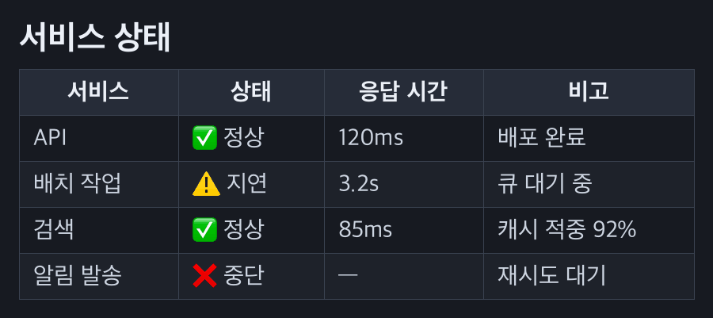
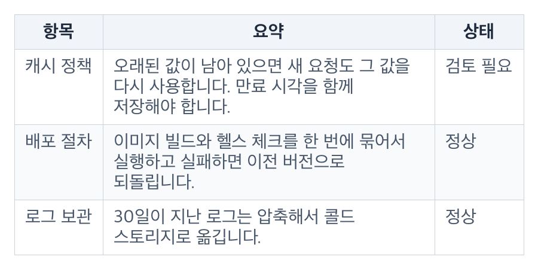

# table-png

[English](https://github.com/elfenomenokim/table-png/blob/main/README.md)

표를 어디서나 제대로 보이는 PNG 이미지로 바꿉니다. 한글, 중국어, 일본어까지 깨지지 않습니다.



메신저, 휴대폰 알림, 봇, 이슈 트래커, SNS 글은 마크다운 표를 그대로 보여 줍니다. `| 서비스 | 상태 |` 같은 세로줄이 그대로 보인다는 뜻입니다. 이 도구는 표를 이미지로 그려서, 읽는 사람이 표를 보게 합니다.

```console
$ pipx install table-png
$ table-png status.md --out status.png
```

## 왜 쓰나

- **한글이 실제로 나옵니다.** macOS, Linux, Windows에서 쓸 수 있는 한글 폰트를 찾아 쓰고, 빠진 기호는 글자마다 다른 폰트로 넘겨 그립니다.
- **컬러 이모지.** ✅ ⚠️ ❌과 가족·국기 조합은 컬러 이모지 폰트가 있으면 컬러로 그립니다. 없으면 네모로 보이고, 어떤 폰트를 설치하면 되는지 알려 줍니다.
- **휴대폰에서 읽힙니다.** 긴 글은 칸 안에서 줄바꿈되고, 칸 너비는 표 전체에서 균형을 잡고, 줄이 많으면 읽기 힘든 띠 모양으로 줄이지 않고 페이지를 나눕니다.
- **입력 세 가지.** JSON, 마크다운 표, CSV를 받습니다. `**굵게**`, `` `코드` ``, 링크 같은 마크다운 표시는 걷어 내고 글자만 남기므로, 문서에서 표를 그대로 복사해도 됩니다. 마크다운 답변을 통째로 넣어도 됩니다. 첫 번째 표만 쓰고 앞뒤 문장은 무시합니다.
- **의존성 하나.** Pillow뿐입니다. 브라우저도, 헤드리스 크롬도, 네트워크도 쓰지 않습니다.

## 설치

```console
$ pipx install table-png     # 권장: 격리 설치, PATH에 명령이 생깁니다
$ uvx table-png --help       # 설치 없이 한 번만 실행
$ pip install table-png      # 프로젝트 안에서
```

Python 3.9 이상이 필요합니다. 꼭 필요한 패키지만 넣은 Linux라면 한글 폰트도 함께 설치합니다.

```console
$ sudo apt install fonts-noto-cjk fonts-noto-color-emoji
```

## 쓰는 법

### 마크다운 표

```console
$ table-png status.md --out status.png
```

```markdown
| 서비스 | 상태 | 응답 시간 |
|---|---|---|
| API | ✅ 정상 | 120ms |
| 배치 작업 | ⚠️ 지연 | 3.2s |
| 알림 발송 | ❌ 중단 | — |
```

### CSV

```console
$ table-png report.csv --out report.png --title "주간 리포트"
```

### JSON

```console
$ table-png table.json --out table.png
```

```json
{
  "headers": ["항목", "수량", "설명"],
  "rows": [
    ["사과", 12, "아삭하고 달콤한 국내산 사과"],
    ["배", 3, "긴 설명도 셀 너비 안에서 줄바꿈됩니다"]
  ],
  "align": ["l", "r", "l"]
}
```

`align`은 넣지 않아도 됩니다. 값은 `l`, `c`, `r`이고 기본값은 `l`입니다.

### 다른 명령의 출력을 그대로 받기

```console
$ some-command --format markdown | table-png - --out out.png
```

`-`가 기본 입력이라, 표가 표준입력으로 들어오면 마지막 인자를 빼도 됩니다.

### 어두운 테마

어두운 메신저나 어두운 슬라이드 배경에 씁니다.

```console
$ table-png status.md --out status-dark.png --theme dark
```



### 긴 칸

긴 글은 칸 안에서 줄바꿈되고 줄 높이가 늘어납니다. 표는 읽을 수 있는 모양을 유지합니다.



## 옵션

| 옵션 | 기본값 | 뜻 |
|---|---|---|
| `INPUT` | 표준입력 | 입력 파일. `-`이면 표준입력 |
| `-o`, `--out PATH` | 필수 | 출력 PNG. 페이지를 나누면 `-001`, `-002`가 붙습니다 |
| `-f`, `--format auto\|json\|markdown\|csv` | `auto` | 입력 형식. `auto`는 내용을 먼저 보고, 다음에 확장자를 봅니다 |
| `--title TEXT` | 없음 | 표 위에 그릴 제목 |
| `-w`, `--width PX` | `1080` | 이미지 너비. 720–1600으로 맞춰집니다 |
| `--font-size PX` | `30` | 본문 글자 크기. 여백과 제목도 같이 커집니다 |
| `--rows-per-page N` | `40` | 이미지 하나에 넣을 줄 수. 넘으면 페이지를 나눕니다 |
| `--theme light\|dark` | `light` | 색 테마 |
| `--font PATH` | 자동 | 한글을 그릴 폰트 파일 |
| `--emoji-font PATH` | 자동 | 컬러 이모지 폰트 파일 |
| `--json` | 끔 | 기계가 읽을 결과를 출력 |
| `--version` | | 버전 출력 |

환경변수 `TABLE_PNG_FONT`, `TABLE_PNG_EMOJI_FONT`는 `--font`, `--emoji-font`와 같은 일을 합니다.

### 결과 객체

`--json`을 주면 결과를 JSON 하나로 출력하고, 실패하면 0이 아닌 값으로 끝납니다.

```json
{"ok":true,"png":"/abs/status.png","width":1080,"height":401,"rows":4}
```

페이지를 나눈 경우에는 배열이 나옵니다. `"png": ["…-001.png", "…-002.png"]`이고 `"height"`도 같은 순서의 배열입니다. 오류는 `{"error":"…"}`를 출력하고 종료 코드 1로 끝납니다.

## 파이썬에서 쓰기

```python
from pathlib import Path

from table_png import RenderOptions, read_table, render_table

table = read_table("| 이름 | 점수 |\n|---|---|\n| 김 | 92 |", fmt="markdown")
result = render_table(
    table,
    Path("score.png"),
    RenderOptions(title="점수", theme="dark", width=900),
)
print(result["png"], result["height"])
```

`read_table(text, fmt="auto")`는 문자열을, `read_source(path_or_dash)`는 파일이나 표준입력을 읽습니다. `render_table(table, path, options)`이 실제로 그립니다.

## 폰트

불러오기에 성공한 첫 폰트를 씁니다. `--font`나 `TABLE_PNG_FONT`로 바꿀 수 있습니다.

| 플랫폼 | 본문 폰트 | 컬러 이모지 |
|---|---|---|
| macOS | Apple SD Gothic Neo, PingFang, Arial Unicode | Apple Color Emoji |
| Linux | Noto Sans CJK(배포판별 경로 여러 개), NanumGothic, UnDotum, 그다음 `fc-match sans-serif:lang=ko` | Noto Color Emoji, 그다음 `fc-match emoji` |
| Windows | 맑은 고딕, 유고딕, Microsoft YaHei, MS Gothic, SimSun | Segoe UI Emoji |

macOS와 Ubuntu 24.04에서 시험했습니다. Windows 폰트 경로는 표준 경로지만 아직 시험하지 않았습니다. 써 보시고 알려 주시면 반영하겠습니다.

한글 폰트를 하나도 찾지 못하면 빈 네모를 그리는 대신, `--font`와 `TABLE_PNG_FONT`를 알려 주는 오류로 끝납니다.

## 에이전트에서 쓰기

AI 에이전트가 표 이미지를 만들어야 한다면 [AGENTS.md](https://github.com/elfenomenokim/table-png/blob/main/AGENTS.md)를 읽으세요. Claude Code 스킬은 [`skill/table-png/SKILL.md`](https://github.com/elfenomenokim/table-png/blob/main/skill/table-png/SKILL.md)에 있습니다. 이 폴더를 `~/.claude/skills/table-png/`로 복사하면 설치됩니다.

## 라이선스

MIT입니다. [LICENSE](https://github.com/elfenomenokim/table-png/blob/main/LICENSE)를 보세요.
