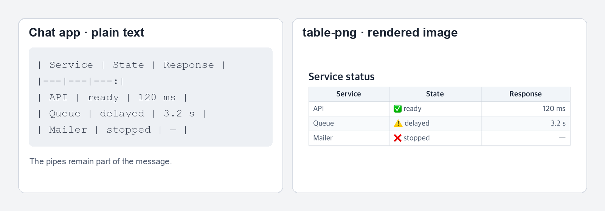
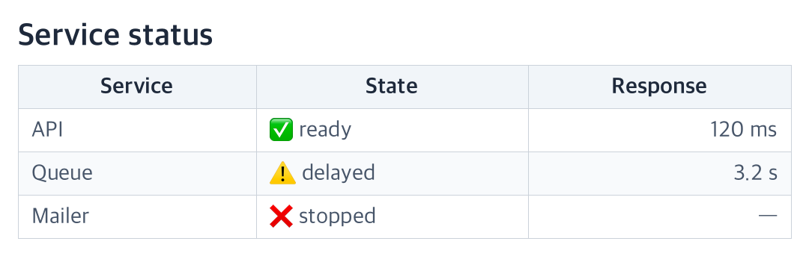

# table-png

[한국어](README.ko.md)

A command-line tool that renders Markdown, CSV or JSON tables as PNG images for places that do not display tables.



## Install

```console
$ pipx install table-png
$ uv tool install table-png
```

Python 3.9 or newer; Pillow is the only runtime dependency.

## Quick start

```console
$ table-png docs/demo/status.md --out /tmp/table-status.png --title "Service status"
/private/tmp/table-status.png

$ table-png docs/demo/status.csv --out /tmp/table-status-csv.png --title "Service status"
/private/tmp/table-status-csv.png

$ table-png docs/demo/status.json --out /tmp/table-status-json.png --title "Service status" --theme dark
/private/tmp/table-status-json.png
```

`status.md` can contain a Markdown pipe table. The command also reads CSV and JSON, or a table piped to `table-png - --out status.png`. `--theme dark` draws the same input for a dark background.

```markdown
| Service | State | Response |
|---|---|---:|
| API | ✅ ready | 120 ms |
| Queue | ⚠️ delayed | 3.2 s |
| Mailer | ❌ stopped | — |
```



## Why

Some chat, notification and image-only fields display Markdown pipes as text. `table-png` draws the cells into an image. It searches for CJK-capable text and emoji fonts on macOS, Linux and Windows; when a CJK font is missing, it reports the font option to use.

<picture>
  <source media="(prefers-color-scheme: dark)" srcset="https://raw.githubusercontent.com/elfenomenokim/table-png/main/docs/diagrams/render-flow.dark.svg">
  <source media="(prefers-color-scheme: light)" srcset="https://raw.githubusercontent.com/elfenomenokim/table-png/main/docs/diagrams/render-flow.light.svg">
  
</picture>

Cells wrap to fit the image. Tables longer than `--rows-per-page` (40 by default) produce numbered PNG pages. Width is clamped to 720–1600 pixels.

## Options

| Option | Default | Purpose |
|---|---|---|
| `INPUT` | `-` (stdin) | File path or standard input |
| `-o`, `--out PATH` | required | Output image path |
| `-f`, `--format` | `auto` | `auto`, `markdown`, `csv` or `json` |
| `--title TEXT` | none | Text above the table |
| `-w`, `--width PX` | `1080` | Image width, clamped to 720–1600 |
| `--rows-per-page N` | `40` | Rows in each image |
| `--theme` | `light` | `light` or `dark` |
| `--json` | off | Print output path and image dimensions as JSON |

## Limits

Pillow and a suitable local font are required. This project has been exercised on macOS, Ubuntu 24.04 and Windows 11. On Windows, flag emoji render as country letters and family emoji sequences render as separate faces.

## License

MIT.

Tables with too many columns for the selected width are rejected; increase `--width` or reduce the columns.
