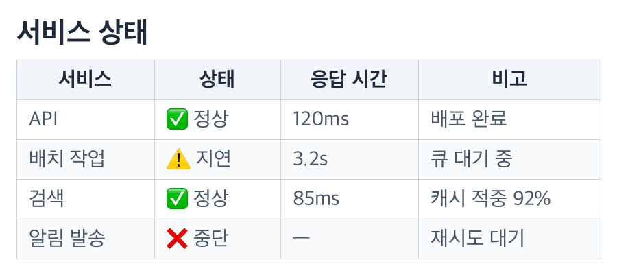
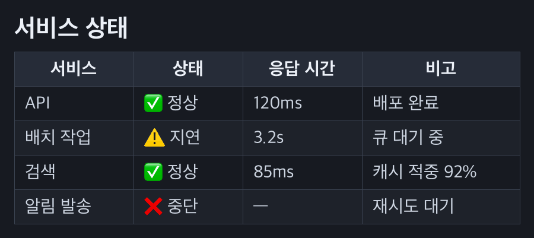

# table-png

[한국어](https://github.com/elfenomenokim/table-png/blob/main/README.ko.md)

Turn a table into a PNG image that renders correctly everywhere — Korean, Chinese and Japanese text included.



Chat apps, phone notifications, bots, issue trackers and social posts all show Markdown as literal pipes. This tool draws the table as an image instead, so the reader sees a table and not `| 서비스 | 상태 |`.

```console
$ pipx install table-png
$ table-png status.md --out status.png
```

## Why

- **CJK text that actually renders.** The renderer picks a Korean-capable font on macOS, Linux and Windows, and falls back per glyph when a symbol is missing.
- **Colour emoji.** ✅ ⚠️ ❌ and family or flag sequences stay in colour when the system has a colour emoji font. Without one they show as boxes, and the command tells you which font to install.
- **Readable on a phone.** Cells wrap inside their column, widths balance across the table, and a long table paginates instead of shrinking to an unreadable strip.
- **Three input formats.** JSON, a Markdown pipe table, or CSV. Markdown markup (`**bold**`, `` `code` ``, links) is stripped to plain text, so a table copied out of a document works as is. Give it a whole Markdown answer: the first table is used and the prose around it is ignored.
- **One dependency.** Pillow. No browser, no headless Chrome, no network.

## Install

```console
$ pipx install table-png     # recommended: isolated, on PATH
$ uvx table-png --help       # or run without installing
$ pip install table-png      # inside a project
```

Python 3.9 or newer. On a minimal Linux box you also need a CJK font:

```console
$ sudo apt install fonts-noto-cjk fonts-noto-color-emoji
```

## Usage

### Markdown table

```console
$ table-png status.md --out status.png
```

```markdown
| 서비스 | 상태 | 응답 시간 |
|---|---|---|
| API | ✅ 정상 | 120ms |
| 배치 작업 | ⚠️ 지연 | 3.2s |
| 알림 발송 | ❌ 중단 | — |
```

### CSV

```console
$ table-png report.csv --out report.png --title "주간 리포트"
```

### JSON

```console
$ table-png table.json --out table.png
```

```json
{
  "headers": ["항목", "수량", "설명"],
  "rows": [
    ["사과", 12, "아삭하고 달콤한 국내산 사과"],
    ["배", 3, "긴 설명도 셀 너비 안에서 줄바꿈됩니다"]
  ],
  "align": ["l", "r", "l"]
}
```

`align` is optional; each entry is `l`, `c` or `r` and defaults to `l`.

### Pipe from another command

```console
$ some-command --format markdown | table-png - --out out.png
```

`-` is the default input, so the last argument can be omitted when the table arrives on stdin.

### Dark theme

For a dark chat client or a dark slide background:

```console
$ table-png status.md --out status-dark.png --theme dark
```



### Wrapped cells

Long text wraps inside its column; the row grows and the table stays readable:


## Options

| Option | Default | Meaning |
|---|---|---|
| `INPUT` | stdin | Input file, or `-` for stdin |
| `-o`, `--out PATH` | required | Output PNG. Pagination adds `-001`, `-002`, … |
| `-f`, `--format auto\|json\|markdown\|csv` | `auto` | Input format. `auto` looks at the content, then the file extension |
| `--title TEXT` | empty | Heading drawn above the table |
| `-w`, `--width PX` | `1080` | Image width, clamped to 720–1600 |
| `--font-size PX` | `30` | Body text size; padding and title scale with it |
| `--rows-per-page N` | `40` | Rows per image before pagination |
| `--theme light\|dark` | `light` | Colour theme |
| `--font PATH` | auto | CJK-capable font file |
| `--emoji-font PATH` | auto | Colour emoji font file |
| `--json` | off | Print the machine-readable result object |
| `--version` | | Print the version |

Environment variables: `TABLE_PNG_FONT` and `TABLE_PNG_EMOJI_FONT` do the same as `--font` and `--emoji-font`.

### Result object

With `--json` the command prints one JSON object and exits non-zero on failure:

```json
{"ok":true,"png":"/abs/status.png","width":1080,"height":401,"rows":4}
```

A paginated render returns arrays: `"png": ["…-001.png", "…-002.png"]` and a matching `"height"`. An error prints `{"error":"…"}` and exits 1.

## Python API

```python
from pathlib import Path

from table_png import RenderOptions, read_table, render_table

table = read_table("| 이름 | 점수 |\n|---|---|\n| 김 | 92 |", fmt="markdown")
result = render_table(
    table,
    Path("score.png"),
    RenderOptions(title="점수", theme="dark", width=900),
)
print(result["png"], result["height"])
```

`read_table(text, fmt="auto")` parses a string; `read_source(path_or_dash)` reads a file or stdin; `render_table(table, path, options)` draws the pages.

## Fonts

The first font that loads wins. Override it with `--font` or `TABLE_PNG_FONT`.

| Platform | Text font | Colour emoji |
|---|---|---|
| macOS | Apple SD Gothic Neo, PingFang, Arial Unicode | Apple Color Emoji |
| Linux | Noto Sans CJK (several distro paths), NanumGothic, UnDotum, then `fc-match sans-serif:lang=ko` | Noto Color Emoji, then `fc-match emoji` |
| Windows | Malgun Gothic, Yu Gothic, Microsoft YaHei, MS Gothic, SimSun | Segoe UI Emoji |

Tested on macOS, Ubuntu 24.04 and Windows 11. On Windows, Segoe UI Emoji draws in colour, but Windows has no flag emoji (🇰🇷 shows as the letters KR) and family sequences such as 👨‍👩‍👧 come out as separate faces.

If no CJK font can be found, the command fails with a message that names `--font` and `TABLE_PNG_FONT` instead of drawing empty boxes.

## Agents

If you are an AI agent asked to produce a table image, read [AGENTS.md](https://github.com/elfenomenokim/table-png/blob/main/AGENTS.md). The Claude Code skill lives in [`skill/table-png/SKILL.md`](https://github.com/elfenomenokim/table-png/blob/main/skill/table-png/SKILL.md); install it by copying that folder to `~/.claude/skills/table-png/`.

## License

MIT — see [LICENSE](https://github.com/elfenomenokim/table-png/blob/main/LICENSE).
